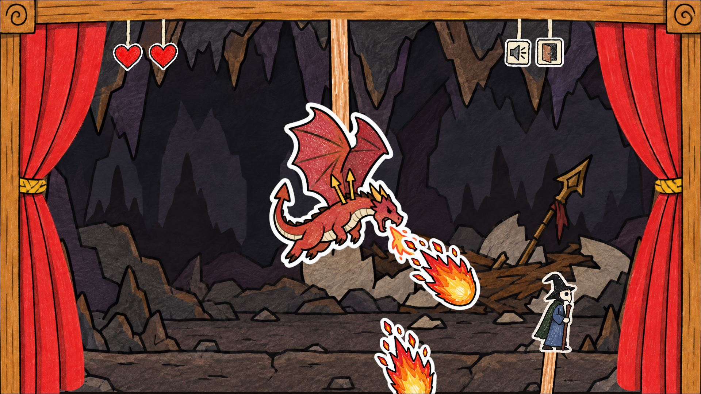
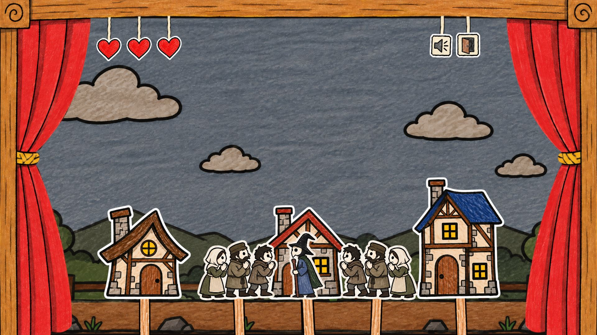
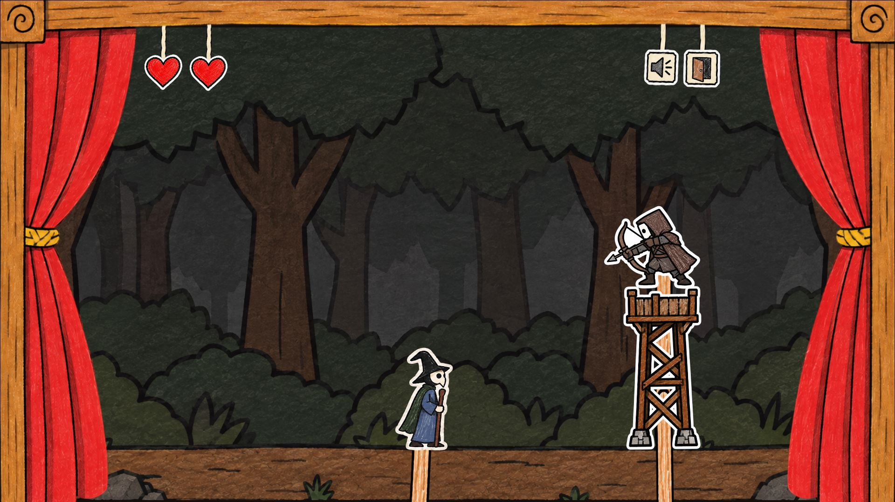
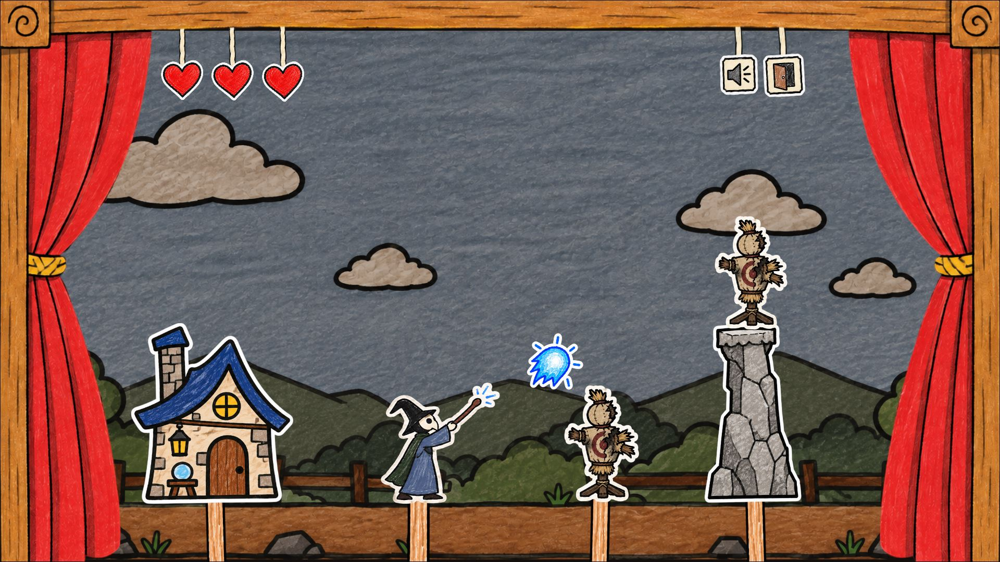
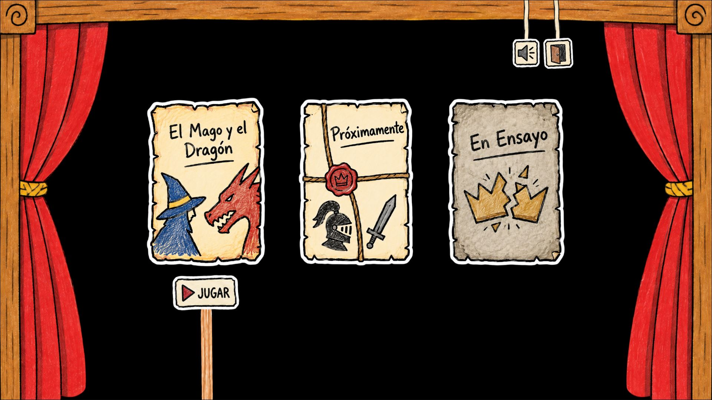
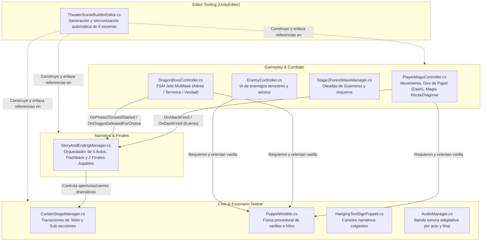
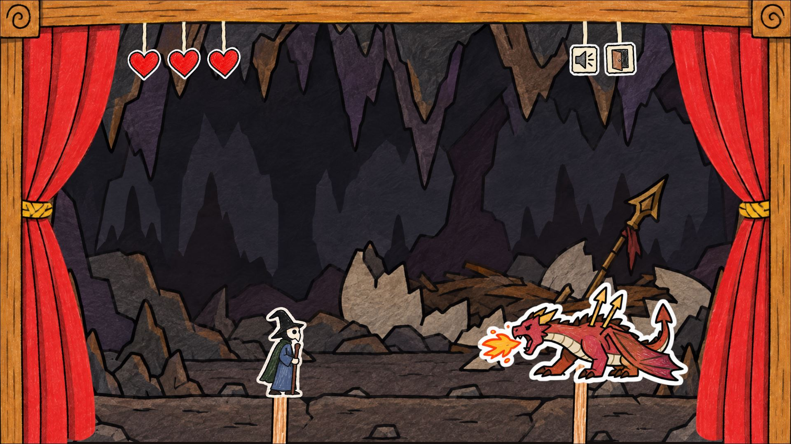

# Un Cuento Más — *2D Puppet Theater Action & Narrative Game*

[](https://eduardoviscarra.itch.io/un-cuento-mas) [](https://eduardoviscarra.itch.io/un-cuento-mas)
[](https://github.com/Gabosito1314/UnCuentoMas/releases/tag/v1.0.0)

-black?logo=unity)
-239120?logo=csharp)


> **Juego 2D de acción, combate y narrativa ramificada ambientado en un teatro de títeres medieval**, donde cada personaje, enemigo, jefe, cartel de diálogo e interfaz cuelga de varillas e hilos animados proceduralmente, y donde la decisión moral final transforma el escenario entero.

<p align="center">
  
  
</p>

<p align="center">
  
  
  
</p>

---

## Ficha Técnica

| Atributo | Detalle |
| :--- | :--- |
| **Motor y Versión** | Unity 6 (`6000.6.4f1`) — Universal Render Pipeline (URP 2D) |
| **Lenguaje** | C# (Namespaces modulares `UnCuentoMas`, `UnCuentoMas.Editor`) |
| **Género** | 2D Action-Platformer / Boss Rush / Narrativa Interactiva con Múltiples Finales |
| **Sistemas Destacados** | FSM de Jefe Multifase, Animación Procedural de Títeres (`Squash & Stretch` + Oscilación), Sistema de Telón Escénico, Constructor Automático de Escenas en `UnityEditor` |
| **Código Fuente Principal** | [`Assets/_Project/Scripts/`](Assets/_Project/Scripts/) |

---

## Arquitectura de Sistemas

El proyecto separa la lógica de **Combate**, **Control del Jugador**, **Orquestación Narrativa**, **Transiciones Escénicas (Telón)** y **Herramientas de Editor (`UnityEditor`)**, comunicando las acciones mediante eventos desacoplados (`Observer Pattern`).



---

## Retos Técnicos y Sistemas Clave (Code Highlights)

### 1. Máquina de Estados (FSM) del Jefe Dragón Multifase y Cambio Dinámico de Varilla
**Código fuente:** [`Assets/_Project/Scripts/Combat/DragonBossController.cs`](Assets/_Project/Scripts/Combat/DragonBossController.cs)

El combate final en la Cueva del Dragón (`Stage 3`) implementa una máquina de estados con 3 fases (`Phase1_Aerial`, `Phase2_Ground`, `Phase3_DefeatedTruth`) que altera tanto las mecánicas de combate como la **orientación física del títere en el escenario**:
* **Fase 1 (Aérea):** El dragón cuelga de una varilla desde el **techo del teatro** (`_wobble.ApplyStickOrientation(fromTop: true)`), patrulla horizontalmente con seguimiento visual (`flipX` hacia el jugador) y solo es vulnerable al **hechizo diagonal**. Sus bolas de fuego aéreas pueden ser interceptadas y anuladas en el aire por los proyectiles del Mago.
* **Fase 2 (Terrestre):** Al caer su salud bajo el umbral de fase, el dragón desciende al suelo y su varilla pasa a sostenerlo **desde abajo del escenario** (`fromTop: false`). Alterna entre ráfagas destructibles y llamaradas rasantes que exigen salto preciso o *Dash*.
* **Fase 3 (Revelación y Decisión Moral):** Detiene el bucle de combate y dispara la cinemática de *flashback* en el teatro antes de desplegar los dos carteles colgantes de decisión final (**Perdonar al Dragón** vs. **Matar al Dragón**).

<p align="center">
  
  
</p>

---

### 2. Controlador del Jugador: Detección de Colisión Dual y "Giro de Papel"
**Código fuente:** [`Assets/_Project/Scripts/Player/PlayerMagoController.cs`](Assets/_Project/Scripts/Player/PlayerMagoController.cs)

Para lograr que el Mago se sienta como una figura de cartón recortado sobre un soporte de madera sin sacrificar precisión en el combate 2D:
* **Flip de Recorte de Cartón y Squash/Stretch:** Al cambiar de dirección o saltar, se interpola la escala horizontal (`_currentFlipScaleX`) simulando el giro físico de una figura plana de papel y aplicando deformación elástica (`Squash & Stretch`) sin revelar el borde inferior de la varilla bajo el telón.
* **Detección Física Doble en Proyectiles:** Los hechizos (tiro recto/diagonal y versión cargada manteniendo el clic) combinan `Rigidbody2D` cinemático con barrido `Physics2D.OverlapCircleAll` por fotograma para garantizar **cero *tunneling*** (ningún proyectil atraviesa enemigos rápidos o bolas de fuego sin registrar impacto).
* **Desacoplamiento con Eventos C#:** Expone `event Action<bool, bool> OnAttackFired` y `event Action OnDashFired` para que el sistema de tutorial y narrativa reaccione sin acoplar el controlador del jugador a la UI.

---

### 3. Orquestador Narrativo de 5 Actos, Flashback Teatral y 2 Finales Jugables
**Código fuente:** [`Assets/_Project/Scripts/Narrative/StoryAndEndingManager.cs`](Assets/_Project/Scripts/Narrative/StoryAndEndingManager.cs)

En lugar de resolver el desenlace con una pantalla estática, **ambos finales son secuencias jugables** de regreso por las escenas nocturnas (`Stage4_BosqueNoche` y `Stage5_PuebloNoche`):
* **Tutorial Guiado por Eventos (`Stage1TutorialStep`):** Máquina de 14 estados en el Acto 1 que baja y sube carteles colgantes (`HangingTextSignPuppet`) validando movimiento, exploración del pueblo vacío, tiro recto, tiro diagonal a maniquíes en altura y *Dash* (`Shift`).
* **Flashback Escénico ("El día de ayer"):** Cierra el telón, pausa la música, reemplaza el estado del nido de huevos del dragón (`dragonNestFrames[0]` → `dragonNestFrames[1]`) y coreografía la entrada de los aldeanos y el Rey para revelar la traición.
* **Final A (Perdonar al Dragón) vs. Final B (Matar al Dragón):** Cambia el estado persistente del mundo, la iluminación, el modelo del Mago (`UseFinalWizardModelStatic`), el comportamiento de los NPCs (que siguen al jugador con la mirada o lo acorralan lentamente mientras baja el telón) y el cartel de epílogo.

---

### 4. Herramienta de Automatización en Unity Editor (`Scene Builder v6`)
**Código fuente:** [`Assets/_Project/Scripts/Editor/TheaterSceneBuilderEditor.cs`](Assets/_Project/Scripts/Editor/TheaterSceneBuilderEditor.cs)

Para acelerar la iteración de diseño y garantizar consistencia de capas (`Sorting Orders`), fuentes tipográficas (`IM Fell English SDF`) y referencias entre las 6 escenas del juego:
* Agrega un menú personalizado **`Un Cuento Más/*`** en la barra superior de Unity (`[MenuItem]`) y validación automática (`[InitializeOnLoad]`).
* Construye y sincroniza programáticamente `Stage0_MainMenu`, `Stage1_Pueblo`, `Stage2_Bosque`, `Stage3_CuevaDragon`, `Stage4_BosqueNoche` y `Stage5_PuebloNoche`, registrándolas automáticamente en `EditorBuildSettings.scenes`.

---

### 5. Sistema de Telón Escénico y Animación Procedural de Títeres
**Código fuente:** [`CurtainStageManager.cs`](Assets/_Project/Scripts/Core/CurtainStageManager.cs) · [`PuppetWobble.cs`](Assets/_Project/Scripts/Core/PuppetWobble.cs) · [`HangingTextSignPuppet.cs`](Assets/_Project/Scripts/Core/HangingTextSignPuppet.cs)

* **`CurtainStageManager`:** Gestiona las transiciones entre sub-secciones de un mismo escenario y entre escenas distintas mediante una secuencia de frames de telón (`Abiertas` → `Entreabiertas` → `Cerradas`), ocultando el cambio de decorado como en una obra de teatro real.
* **`PuppetWobble`:** Calcula oscilación sinusoidal de rotación y cabeceo vertical en función de la velocidad de desplazamiento del personaje o NPC, además de instanciar y posicionar automáticamente el soporte de madera (`Palito`) por detrás del sprite para ocultar la unión.

---

## Estructura del Código (`Assets/_Project/Scripts/`)

```text
Assets/_Project/Scripts/
├── Combat/
│   ├── DragonBossController.cs      # FSM del Jefe Dragón (Fase Aérea, Terrestre y Decisión Final)
│   ├── EnemyController.cs           # IA, patrullaje, defensa y disparo de Guerreros y Arqueros
│   └── Stage2ForestWaveManager.cs   # Control de oleadas y bloqueo/desbloqueo de avance en el Bosque
├── Core/
│   ├── AudioManager.cs              # Singleton de música por Stage/Final y pool de SFX
│   ├── CurtainStageManager.cs       # Transiciones de telón rojo y navegación bidireccional de escenas
│   ├── EpilogueSignPuppet.cs        # Cartel colgante de cierre dramático para Final A y Final B
│   ├── HangingTextSignPuppet.cs     # Carteles de diálogo y elecciones con cuerdas animadas
│   ├── MainMenuController.cs        # Flujo de telón inicial y selector de cuentos (capítulos)
│   ├── PuppetHeartHUD.cs            # Corazones de vida suspendidos con hilos y animación de balanceo
│   ├── PuppetWobble.cs              # Componente procedural de varilla e inclinación de títere
│   ├── StageNPCPuppet.cs            # Comportamiento de aldeanos (seguimiento visual flipX y estados)
│   ├── StageTopRightHUD.cs          # Botones colgantes de audio y retorno al menú
│   ├── TheaterCursorManager.cs      # Cursor personalizado temático
│   ├── TheaterSpriteLibrary.cs      # ScriptableObject centralizado de referencias de sprites
│   └── TrainingDummyPuppet.cs       # Maniquíes de entrenamiento con feedback de daño y estado roto
├── Editor/
│   └── TheaterSceneBuilderEditor.cs # Herramienta UnityEditor para generación y sincronización de escenas
├── Narrative/
│   └── StoryAndEndingManager.cs     # Orquestador de tutorial, narrativa, flashback y los 2 finales
└── Player/
    └── PlayerMagoController.cs      # Movimiento 2D, Squash & Stretch, hechizos cargados y Dash
```

---

## Controles

| Acción | Control |
| :--- | :--- |
| **Moverse a Izquierda / Derecha** | `A` / `D` o Flechas `←` / `→` |
| **Saltar** | `Espacio` o `W` |
| **Hechizo Recto (Débil / Cargado)** | `Clic Izquierdo` (Pulsar = rápido / Mantener = disparo fuerte) |
| **Hechizo Aéreo Diagonal (Débil / Cargado)** | `Clic Derecho` (Pulsar = rápido / Mantener = disparo fuerte) |
| **Giro de Papel (Dash evasivo)** | `Shift Izquierdo` |
| **Reiniciar tras completar un final** | `R` o Botón Colgante de Menú |

---

## Jugar Ahora y Cómo Abrir el Proyecto en Unity

* **Página Oficial en Itch.io (Jugar / Descargar):** [**eduardoviscarra.itch.io/un-cuento-mas**](https://eduardoviscarra.itch.io/un-cuento-mas)
* **Build Jugable Directa (Windows `.zip`):** Disponible en [**GitHub Releases (v1.0.0)**](https://github.com/Gabosito1314/UnCuentoMas/releases/tag/v1.0.0).

### Abrir el Código Fuente en Unity 6
1. Clonar este repositorio:
   ```bash
   git clone https://github.com/Gabosito1314/UnCuentoMas.git
   ```
2. Abrir **Unity Hub** y agregar la carpeta del proyecto (`Add project from disk`).
3. Abrir con **Unity 6 (`6000.6.4f1` o superior compatible)**.
4. Abrir la escena inicial en `Assets/_Project/Scenes/Stage0_MainMenu.unity` y presionar **Play**, o utilizar el menú superior **`Un Cuento Más`** para inspeccionar las herramientas de automatización de escenas.

---

## Autor

**Eduardo Gabriel Viscarra Quisbert** — [GitHub `@Gabosito1314`](https://github.com/Gabosito1314) · [Itch.io `eduardoviscarra.itch.io`](https://eduardoviscarra.itch.io/) — *Desarrollador de Videojuegos en Unity (2D / 3D) & Game Designer*
